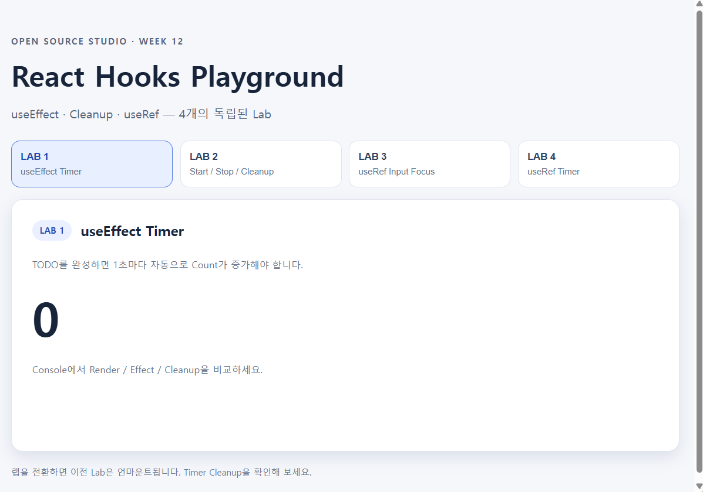

# OSS Week 12 — React Hooks Playground (Student Starter)
## 22200635 장영진

## Installation: 설치·실행 방법 및 실행 화면
Node.js 20.19+ 또는 22.12+ 권장. 프로젝트 폴더에서 실행:

```bash
npm install
npm run dev
```


브라우저에 터미널의 Local URL을 열고 LAB 탭을 이동하세요. 제출 전 `npm run build`도 실행하세요.

## Project Information: 프로젝트 소개 및 Starter Project 정보
1. 리엑트 훅의 동작을 확인하는 프로젝트
2. lab1~4까지의 코드를 완성하며 useEffect, useRef등 사용법을 배우기 위한 실습니다.


## 수행 방법
1. `src/components/` 아래의 LAB 1~4 파일에 있는 `TODO`를 직접 완성합니다.
2. `src/App.jsx`, `src/App.css`는 공통 화면이므로 가급적 수정하지 않습니다.
3. 각 LAB의 동작 화면과 콘솔 결과를 기록합니다.
4. 한 LAB에서 다른 LAB으로 탭을 전환하면 기존 컴포넌트가 언마운트됩니다. Cleanup 결과를 관찰합니다.

## Source Code Exploration: 주요 파일 구조, useEffect 및 useRef 분석, 주요 코드 2개 설명
1. Project Structure: App.jsx와 주요 Lab 컴포넌트의 역할
- App.jsx는 전체 화면 구성을 담당, Lab 컴포넌트는 각 실습 기능을 담당한다.

2. useEffect: Effect, Dependency Array 및 Cleanup의 동작 원리
- lab1에서 useEffect로 타이머를 시작한다. 화면이 랜더링 된 후 실행할 작업을 작성하는 리엑트 훅이기 떄문이다.
- Dependency Array는 effect를 다시 실행하기 위한 기준이 되는 값이다. lab1에서 []를 사용하여 카운트가 바뀌며 랜더링 돼어도 effect를 실행하지 않도록 사용했다.
- Cleanup은 첫번째 effect후 다음 effect 실행전에 effect가 수행한 작업을 정리하며 다시 실행 전, 컴포넌트가 사라지기 전 호출된다. lab4에서는 타이머id를 useRef에 보관한다. 컴포넌트가 사라질 때 Cleanup이 보관한 ID를 이용하여 타이머가 남아있지 않게 정리한다.

3. useRef: .current 속성과 useState의 차이
- .current는 값을 바꿔도 컴포넌트가 리랜더링되지 않는다.
- useState는 값을 바꾸면 컴포넌트가 랜더링된다.

4. Code Analysis: useEffect와 useRef 관련 주요 코드 각 2개(5~15줄)를 선택하여 동작 원리 설명
- useEffect(() => {  
    const id = setInterval(() => {  
      setCount(prev => prev + 1);  
    }, 1000);  
  
    return () => clearInterval(id);  
  }, []);  
  컴포넌트가 화면에 나타나고 타이머가 시작.  
  []를 사용해 카운트가 바뀌며 리랜더링 되어도 effect가 반복하지 않고, 컴포넌트가 사라질 때 Cleanup이 타이머를 멈춘다. 

-  const inputRef = useRef(null);

  const focusInput = () => {
    inputRef.current.focus();
    // TODO 2: ref.current를 이용해 input에 focus() 호출
     }; 
     .  
     .  
     .  
     
     <input id="student-name" className="field" placeholder="Enter your name"
        ref={inputRef}/>  

    useRef(null)을 만들어둔 후, ref={inputRef}로 실제 입력창에 연결한다.  
    커서가 입력창에 놓여진다.

## Lab Implementation: 4개 Lab 구현 내용 및 실행 결과
1. lab1 : useEffect와 setInterval을 이요해 1초마다 카운트가 올라가게 만들었다.
2. lab2 : running상태를 의존성 배열에 두고 상태가 바뀔때(버튼을 누르면) 타이머가 시작, 정지, 초기화되게 구현했다.
3. lab3 : useRef를 입력칸에 연결하여 버튼을 누르면 입력창에 커서가 가도록 만들었다.
4. lab4 : 타이머 ID를 useRef에 저장하고 버튼으로 타이머를 제어. 


## Lab Comparison: STEP 3의 비교 분석 질문 4개에 대한 답변
1. `setCount(prev => prev + 1)`은 왜 유용한가?
- 직전 상태값에서 카운트를 1씩 올리기 때문에 최신 숫자를 정확히 반영할 수 있다.
2. `useEffect(fn, [])`과 `useEffect(fn)`은 어떻게 다른가?
- 언제 실행되는지에 대한 차이가 있다. []일때는 컴포넌트가 처음 나타날 때 실행되지만, 없을때는 랜더링될 때마다 실행된다.
3. Cleanup은 언제 실행되는가? 개발 환경 StrictMode 영향은?
- Effect가 다시 실행되기 전, 컴포넌트가 사라질 때 호출된다. StrictMode가 켜져 있으면 Effect와 Cleanup을 한번 더 실행시킨다.
4. `useState`와 `useRef`의 값 변경 시 렌더링 차이는?
- useState는 값이 바뀌면 그즉시 랜더링을 하며 화면이 바뀌지만, useRef는 값을 수정해도 랜더링이 발생하지 않으며 화면이 바뀌지 않는다. 
5. LAB 2와 LAB 4에서 Timer를 관리하는 방식의 차이는?
- LAB2 start, stop 버튼이 running의 상태를 ture와 false로 바꾸고 useEffect가 다시 타이머를 시작하거나 cleanup으로 바꾸지만, LAB4는 start, stop 함수가 타이머를 직접 시작하거나 멈춘다.

## 선택 기능 구현 - Timer Count를 분/초 형식으로 표시
1. 수정한 파일명:  
 Lab1_EffectTimer.jsx  
 Lab2_TimeerControl.jsx  
 Lab_RefTimer.jsx
2. 변경 내용: count를 초와 분으로 나누고 분:초 형식으로 나타냈다.  


## Customizing: 수정 내용 및 파일명
1. App.css : 백그라운드 컬러 변경, 탭 클래스 백그라운드 컬러 변경, 
2. App.jsx : h1태그 변경
3. index.html : 타이틀 변경

## Deployment: 실제 접근 가능한 Vercel URL


## Weekly Review:
### 새롭게 배운 내용 3가지 :
1. useEffect가 useState와 다르게 상태 변화를 감지하여 실행할 작업을 처리한다는 점을 알게 되었다.
2. 과제에서 타이머 부분을 진행하며 Cleanup이 useEffect가 시작한 작업을 정리하는 함수라는 것을 알게 되었다. 
3. lab3에서 입력칸에 포커스를 주는 실습을 진행하며 useRef가 리랜더링이 되어도 값이 유지된다는 것을 알게 되었다.

### 어려웠던 점과 해결 방법, AI 활용 내용 및 느낀 점
이번 실습은 개념 위주로의 내용이라 모두 어렵지 않았지만 추가 기능을 구현하며(분/초로 표시) 조금 어려움을 겪었다. 그냥 count를 60으로 나누고 분과 초를 구별해서 쓰면 되는줄 알았지만 분이 소수점으로 표기되어서 어떻게 해결해야하는지 몰랐었다. AI의 도움으로 math.함수를 알게 되었고 이를 활용하여 해결했다.  
실습 과제를 진행하면서 useEffect와 그 작업을 정리하는 Cleanup, useRef의 사용법과 어떻게 실행되는지 화면에 어떻게 나타나는지를 확인할 수 있었다. 